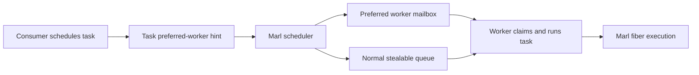
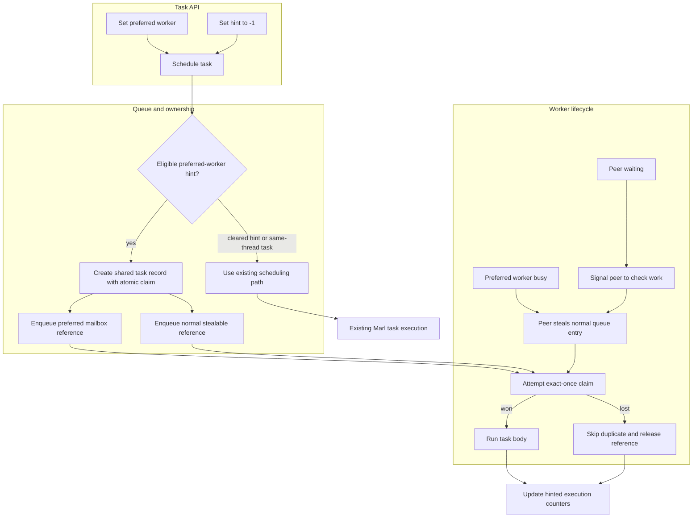

# M:N thread runtime

## Contents

- [Architecture and execution guide](#architecture-and-execution-guide)
- [Implementation techniques](#implementation-techniques)
- [Schedule a preferred worker](#schedule-a-preferred-worker)
- [How the scheduler handles a hint](#how-the-scheduler-handles-a-hint)
- [Build and run](#build-and-run)
- [Measured evidence](#measured-evidence)
- [Upstream source and maintenance](#upstream-source-and-maintenance)

## Architecture and execution guide

This repository extends the preserved Google Marl fiber scheduler with an advisory [preferred-worker](#preferred-worker) hint. Marl owns worker threads, fiber switching, task queues, and [work stealing](#work-stealing). The extension adds an [affinity mailbox](#mailbox) entry and a shared [exact-once claim](#exact-once-claim) record for hinted tasks. [Same-thread tasks](#same-thread-task) retain their existing scheduling behavior.

The hint changes task routing inside Marl rather than replacing its worker runtime.



A hinted task has one shared record referenced from the preferred worker's FIFO mailbox and the ordinary stealable queue. Both routes can race to claim it, but only the first successful atomic claim executes the body. A worker that loses skips the duplicate record and releases its reference. If the preferred worker is busy, a peer can steal from the normal queue. Sleeping peers receive a wake signal so they can look for work. Affinity statistics are cumulative snapshots, and duplicate-skip counts can lag until a losing queue entry drains.



| Subsystem | Responsibility and owned invariant | Source |
| --- | --- | --- |
| Task API | Store or clear the preferred worker index on a task | [`task.h`](include/marl/task.h) |
| Scheduler | Route hinted records to mailbox and stealable queues while retaining same-thread semantics | [`scheduler.cpp`](src/scheduler.cpp) |
| Worker queues | Own queue references and support stealing and worker wakeups | [`scheduler.cpp`](src/scheduler.cpp) |
| Fiber execution | Run the claimed body through Marl's existing fiber scheduler | [`scheduler.h`](include/marl/scheduler.h) |
| Consumer checks | Exercise hints, stealing, duplicate reclamation, and shutdown drain | [`mn_thread_runtime_tests.cpp`](examples/mn_thread_runtime_tests.cpp) |

## Implementation techniques

This section covers the active scheduler, preferred-worker extension, and maintained consumer checks. Marl's stackful fibers and cooperative waits are inherited. Preferred-worker routing and its consumer oracle are local additions. Rationale is inferred from current code. This documentation makes no cache, NUMA, or performance-benefit claim.

| Subsystem | Technique cards | Source files |
| --- | --- | --- |
| Task API | [Advisory worker hints](#technique-preferred-worker), [same-thread routing](#technique-same-thread-task) | [`task.h`](include/marl/task.h), [`scheduler.cpp`](src/scheduler.cpp) |
| Fiber scheduler | [M:N stackful fiber scheduling](#technique-mn-stackful-fibers), [cooperative wait and owner resumption](#technique-cooperative-wait-owner-resumption) | [`scheduler.h`](include/marl/scheduler.h), [`scheduler.cpp`](src/scheduler.cpp) |
| Preferred queues | [Mailbox plus stealable queue](#technique-mailbox), [work stealing and peer wakeup](#technique-work-stealing), [atomic claim and shared-record reclamation](#technique-exact-once-claim) | [`scheduler.h`](include/marl/scheduler.h), [`scheduler.cpp`](src/scheduler.cpp) |
| Lifecycle and counters | [Shutdown drain](#technique-shutdown-drain), [cumulative placement counters](#technique-affinity-counter) | [`scheduler.h`](include/marl/scheduler.h), [`scheduler.cpp`](src/scheduler.cpp) |
| Consumer verification | [Exact consumer stressor oracle](#technique-consumer-stressor-oracle) | [`mn_thread_runtime_tests.cpp`](examples/mn_thread_runtime_tests.cpp) |

<a id="technique-mn-stackful-fibers"></a>

<details>
<summary>M:N stackful fiber scheduling</summary>

**Mechanism.** Marl runs many task fibers on a fixed set of worker threads. Each worker owns its main fiber, task fibers, and fiber queues. A task can yield by switching its stack to another fiber on that same worker. Completed fibers enter the worker's idle set for reuse.

**Example.** A worker starts a task fiber with `createWorkerFiber()`, then `runUntilIdle()` switches from the scheduler fiber to it. The task may yield and resume on the same worker.

**Why here.** Preferred-worker routing selects a queue while Marl's existing worker executes the task as a fiber.

**Tradeoffs.** Fibers do not migrate between worker threads. They use allocated stacks and scheduler-aware waits; a blocking call inside a task can occupy its worker.

**Code and ownership.** Inherited Marl code in [`scheduler.h`](include/marl/scheduler.h#L354), [`scheduler.cpp`](src/scheduler.cpp#L755), [`scheduler.cpp`](src/scheduler.cpp#L810), and [`scheduler.cpp`](src/scheduler.cpp#L821).

</details>

<a id="technique-cooperative-wait-owner-resumption"></a>

<details>
<summary>Cooperative wait and owner resumption</summary>

**Mechanism.** A scheduler-aware wait marks the current fiber yielded or waiting, records a timeout when present, and switches the worker to other work. Notification queues the fiber on its owning worker. That worker resumes the fiber rather than transferring its suspended stack to another thread. Predicate waits recheck after wakeups.

**Example.** `Event::wait()` suspends more task fibers than there are workers. After the event is signaled, each worker resumes its own fibers.

**Why here.** Cooperative waits free a worker to run other tasks while a fiber waits and preserve stack ownership.

**Tradeoffs.** Only Marl-aware waits yield. A regular blocking call still blocks its OS worker. The worker-local design limits migration across workers.

**Code and ownership.** Inherited Marl code in [`scheduler.cpp`](src/scheduler.cpp#L497) and [`scheduler.cpp`](src/scheduler.cpp#L540). The consumer checks owner resumption in [`mn_thread_runtime_tests.cpp`](examples/mn_thread_runtime_tests.cpp#L59).

</details>

<a id="technique-preferred-worker"></a>

<details>
<summary>Advisory worker hints</summary>

**Mechanism.** `Task::setPreferredWorker()` stores a worker index, or `-1` to clear it. The scheduler validates nonnegative indices against its worker count, then routes eligible hinted tasks through that worker's affinity queues. A cleared hint follows ordinary scheduling. `SameThread` tasks take the existing current-worker path first. A single-thread scheduler has no multi-worker routing path.

**Example.** `task.setPreferredWorker(partition % workers)` suggests that tasks for a partition use the same worker index.

**Why here.** The hint exposes a placement preference for iterative partitioned work while leaving the scheduler free to run the task elsewhere.

**Tradeoffs.** A hint is not pinning and guarantees neither worker placement nor hardware locality. Invalid indices fail at scheduling time. Hinted tasks allocate a shared record and use two queue references.

**Code and ownership.** Extension API in [`task.h`](include/marl/task.h#L60) and routing in [`scheduler.cpp`](src/scheduler.cpp#L171).

</details>

<a id="technique-mailbox"></a>

<details>
<summary>Mailbox plus stealable queue</summary>

**Mechanism.** A hinted task moves into one `AffinityTask` shared record. The preferred worker receives one shared reference in its FIFO affinity mailbox, and its ordinary task queue receives another. Both entries point to the same body and claim flag. The mailbox gives the target a direct route; the ordinary queue remains available to thieves.

**Example.** `enqueueAffinity()` appends the record to both queues and increments the queued-work count by two.

**Why here.** The dual reference keeps a preferred route and a peer-stealable fallback without transferring the record when contention appears.

**Tradeoffs.** Each hinted task adds an allocation, a second queue entry, and a later losing-reference drain. The queues use mutexes.

**Code and ownership.** Extension code in [`scheduler.h`](include/marl/scheduler.h#L334) and [`scheduler.cpp`](src/scheduler.cpp#L585).

</details>

<a id="technique-work-stealing"></a>

<details>
<summary>Work stealing and peer wakeup</summary>

**Mechanism.** A worker looking for work probes peer queues and can remove an eligible task from a peer's normal task queue. When a hinted task enters the preferred worker's queues, the scheduler signals other workers so sleeping peers check for stealable work. A thief runs that queue reference through the same claim path as the mailbox reference.

**Example.** While worker 0 is held by a consumer blocker, worker 1 steals tasks whose hint names worker 0.

**Why here.** Stealing keeps hinted tasks runnable when the preferred worker is occupied.

**Tradeoffs.** The worker index is advisory, so execution may occur elsewhere. A wake signal prompts a work check; it does not promise that a peer steals a particular task.

**Code and ownership.** Extension wakeup in [`scheduler.cpp`](src/scheduler.cpp#L188) and inherited steal loop in [`scheduler.cpp`](src/scheduler.cpp#L625).

</details>

<a id="technique-exact-once-claim"></a>

<details>
<summary>Atomic claim and shared-record reclamation</summary>

**Mechanism.** Both queue references reach `Worker::execute()`. A strong compare-and-exchange changes `claimed` from false to true. Only its winner increments the preferred or stolen counter and invokes the body. A loser increments duplicate skips and returns. Each entry owns a `shared_ptr`, so the record and task captures live until both references release them.

**Example.** The consumer checks that each callback count is one and that captures remain alive until duplicate references drain.

**Why here.** Two queue routes can race, so a shared atomic decision prevents duplicate body execution.

**Tradeoffs.** The losing reference must still be dequeued. It can outlive body completion. Shared ownership and an atomic operation add work to each hinted task.

**Code and ownership.** Extension record and claim in [`scheduler.h`](include/marl/scheduler.h#L334) and [`scheduler.cpp`](src/scheduler.cpp#L605). Consumer oracle in [`mn_thread_runtime_tests.cpp`](examples/mn_thread_runtime_tests.cpp#L147).

</details>

<a id="technique-same-thread-task"></a>

<details>
<summary>Same-thread routing precedence</summary>

**Mechanism.** `Scheduler::enqueue()` checks the `SameThread` flag before the worker hint. It places such a task on the current worker and returns. The thief also refuses to steal ordinary same-thread tasks from a peer queue.

**Example.** A task with `SameThread` and a preferred index still runs on the scheduling thread's worker.

**Why here.** The extension preserves Marl's existing task contract instead of letting a placement hint override it.

**Tradeoffs.** Same-thread work cannot use the normal peer-steal fallback. A caller must schedule it on the thread where it must execute.

**Code and ownership.** Inherited flag in [`task.h`](include/marl/task.h#L30) and routing/steal guard in [`scheduler.cpp`](src/scheduler.cpp#L171) and [`scheduler.cpp`](src/scheduler.cpp#L625). Consumer check in [`mn_thread_runtime_tests.cpp`](examples/mn_thread_runtime_tests.cpp#L129).

</details>

<a id="technique-affinity-counter"></a>

<details>
<summary>Cumulative placement counters</summary>

**Mechanism.** The scheduler keeps atomic cumulative counts for bodies claimed by the preferred worker, claimed by another worker, and duplicate entries skipped. `affinityStats()` loads them into a snapshot. It does not wait for all queue references for completed tasks to drain.

**Example.** After a task body completes, duplicate skips may remain unchanged until the losing entry is consumed.

**Why here.** The consumer can classify where task bodies ran and check whether losing references eventually drain.

**Tradeoffs.** These are cumulative snapshots, not per-task live states. Duplicate skips can lag body completion. The counters do not measure cache misses, NUMA placement, or performance.

**Code and ownership.** Extension counters and snapshot in [`scheduler.h`](include/marl/scheduler.h#L51) and [`scheduler.cpp`](src/scheduler.cpp#L222). Consumer drain check in [`mn_thread_runtime_tests.cpp`](examples/mn_thread_runtime_tests.cpp#L207).

</details>

<a id="technique-shutdown-drain"></a>

<details>
<summary>Shutdown drain</summary>

**Mechanism.** A worker keeps its run loop active while shutdown is requested and queued work or blocked fibers remain. Workers process queue entries, including stale duplicate references, before joining. The scheduler destructor waits for bound single-thread workers to unbind, then stops and destroys worker threads.

**Example.** The consumer fills the preferred worker's mailbox while peers steal and run normal queue references, then releases its blocker and destroys the scheduler.

**Why here.** Draining both entries releases task captures and lets accepted callbacks finish before worker teardown.

**Tradeoffs.** Teardown waits for outstanding work and bound threads. A task that never returns or a caller that never unbinds can prevent shutdown from completing.

**Code and ownership.** Inherited worker lifecycle in [`scheduler.cpp`](src/scheduler.cpp#L659) and [`scheduler.cpp`](src/scheduler.cpp#L151). Consumer check in [`mn_thread_runtime_tests.cpp`](examples/mn_thread_runtime_tests.cpp#L235).

</details>

<a id="technique-consumer-stressor-oracle"></a>

<details>
<summary>Exact consumer stressor oracle</summary>

**Mechanism.** The maintained executable controls contention with a blocker, submits a known task count, and checks per-task atomic counts, placement classification, reference-drain counts, and capture destruction. Its stencil path also compares parallel output with a serial checksum and checks hinted executions against the scheduler counter.

**Example.** `testAffinityStealRace()` holds the preferred worker while 128 hinted callbacks run through a peer, then requires every callback count to equal one and all 129 duplicate references to be skipped.

**Why here.** The oracle checks callback ownership and reclamation in the real consumer executable.

**Tradeoffs.** Time-bounded stress tests cover controlled races, not every interleaving. The stencil checksum proves result agreement for its inputs, not locality or speedup.

**Code and ownership.** Repository consumer checks in [`mn_thread_runtime_tests.cpp`](examples/mn_thread_runtime_tests.cpp#L147), [`mn_thread_runtime_tests.cpp`](examples/mn_thread_runtime_tests.cpp#L235), and [`mn_thread_runtime_tests.cpp`](examples/mn_thread_runtime_tests.cpp#L326).

</details>

### Follow a hinted task

1. The consumer configures and binds a Marl scheduler, creates a task, and sets a worker index. `-1` clears the hint; a single-thread scheduler ignores it.
2. Scheduling creates the shared task record and queues one reference in the preferred mailbox and one in the normal work queue.
3. The preferred worker or a stealing peer attempts the atomic claim. The winner runs the task once.
4. The other queue entry later observes the completed claim, skips execution, and releases its reference. Its counter may update after task completion.
5. Shutdown drains remaining queue references; the consumer unbinds a bound scheduler thread before it exits.

<a id="preferred-worker"></a>
<details><summary>What is a preferred worker?</summary>

A preferred worker is the worker the scheduler tries first for a hinted task. The hint is advisory; if that worker is busy, another worker can steal the task.
</details>

<a id="mailbox"></a>
<details><summary>What is the affinity mailbox?</summary>

The affinity mailbox is a FIFO queue tied to a worker. A hinted task adds one reference there, while another reference stays in the normal queue so peers can steal it.
</details>

<a id="work-stealing"></a>
<details><summary>What is work stealing?</summary>

Work stealing lets an idle worker take runnable work from a peer's queue. Marl uses the normal queue as the fallback route when a preferred worker is occupied.
</details>

<a id="exact-once-claim"></a>
<details><summary>What is the exact-once claim?</summary>

The shared task record contains an atomic claim flag. The first worker that claims it runs the body; the second queue reference cannot run it again.
</details>

<a id="same-thread-task"></a>
<details><summary>What is a same-thread task?</summary>

A same-thread task must run on the thread that schedules it. The preferred-worker hint does not override this existing task mode.
</details>

<a id="affinity-counter"></a>
<details><summary>What is an affinity counter?</summary>

An affinity counter records hinted executions on the preferred worker, steals by another worker, or skipped duplicate references. A duplicate-skip count can lag while the losing reference remains queued.
</details>

### Design choices and limits

These rationales are inferred from implementation; the cited paper is the source of the mailbox pattern, not proof of this implementation's performance.

| Choice | Current behavior and rationale | Alternative and cost to reconsider |
| --- | --- | --- |
| Advisory hint instead of pinning | Keeps normal stealing available when the target worker is busy. | Strict pinning can preserve placement but risks idle workers and delayed tasks. |
| Duplicate queue references | Gives the preferred worker a direct route and keeps a stealable fallback. | Single-queue routing avoids duplicates but needs a separate handoff when the target is busy. |
| Shared record with atomic claim | Makes competing routes execute the body once. | Moving tasks between queues avoids shared claim state but adds transfer synchronization. |
| Mutex-protected queues | Reuses Marl's queue and ownership structure. | Lock-free queues require different reclamation and contention evidence. |
| Cumulative advisory statistics | Exposes observed placement without synchronizing task completion. | Exact live counters add synchronization and still do not prove hardware locality. |

This repository extends Google Marl, a C++11 scheduler for stackful fibers and a fixed pool of worker threads. It adds a locality hint for iterative tasks while keeping tasks stealable when the preferred worker is busy.

The runtime serves two needs: ordinary work continues through Marl's scheduler, while repeated partitioned work can ask the scheduler to try the worker that handled the same partition before. The hint is advisory. A busy worker can lose the task to a peer.

## Schedule a preferred worker

Configure a Marl scheduler with dedicated workers, then set a hint on each task:

```cpp
marl::Scheduler::Config config;
config.setWorkerThreadCount(4);
marl::Scheduler scheduler(config);
scheduler.bind();

marl::Task task([partition] { process(partition); });
task.setPreferredWorker(partition % 4);
marl::schedule(std::move(task));
```

Call `marl::Scheduler::unbind()` before the bound thread exits. Use `Task::setPreferredWorker(-1)` to clear the hint. A single-threaded scheduler ignores hints. `SameThread` tasks still run on the thread that schedules them.

`Scheduler::affinityStats()` returns cumulative counts for tasks that have a hint: executions on the preferred worker, executions stolen by another worker, and duplicate references skipped after the task has already run. The counters are snapshots. Duplicate skips can lag task completion until a worker drains the losing queue entry.

## How the scheduler handles a hint

The scheduler puts one shared task record in two places: the preferred worker's FIFO mailbox and its normal stealable queue. The record contains an atomic claim flag. The first worker to claim it runs the body. The other reference is skipped and released. Sleeping peers receive a wake signal so they can steal work instead of waiting for an unrelated task.

This follows the affinity mailbox and duplicate queue entry in Acar, Blelloch, and Blumofe's [The Data Locality of Work Stealing](https://www.cs.cmu.edu/~blelloch/papers/locality2000.pdf), section 7.1. This bounded implementation does not prove the paper's theorem or reproduce its speedups. It uses mutex-protected queues and allocates a shared record for each hinted task. See [the scheduling design](docs/architecture.md) for queue and ownership details.

The coursework context is the CMU 15-418 M:N fiber assignment described in [the course project report](https://wc-0904.github.io/). This repository does not reuse the student implementation.

## Build and run

Use Visual Studio 2022 Build Tools with CMake on Windows:

```powershell
git submodule update --init third_party/googletest
cmake -S . -B build -G "Visual Studio 17 2022" -A x64 -DMARL_BUILD_EXAMPLES=ON -DMARL_BUILD_TESTS=ON
cmake --build build --config Release --target marl-unittests mn_thread_runtime_tests
ctest --test-dir build -C Release --output-on-failure
```

The maintained consumer checks fibers and nested waits with 1, 2, and 4 workers, same-thread execution, owner-thread fiber resumption, stealing while the preferred worker is busy, duplicate reclamation, and shutdown drain. Run the real consumer driver to include a bounded process timeout and retained evidence:

```powershell
powershell -ExecutionPolicy Bypass -File .agents/skills/verify-mn-thread-runtime/scripts/verify.ps1 -Doctor
powershell -ExecutionPolicy Bypass -File .agents/skills/verify-mn-thread-runtime/scripts/verify.ps1
```

To run the stencil workload and emit CSV measurements:

```powershell
build/Release/mn_thread_runtime_tests.exe --benchmark
```

## Measured evidence

The consumer and upstream CTest suites passed on both Windows and Ubuntu in [native CI run 39716823237](https://github.com/STEVVVU/mn-thread-runtime/actions/runs/39716823237). Main also reran the maintained Windows process driver at `run-20261022-032459-699`; its evidence survived scratch cleanup.

The longer [native campaign](https://github.com/STEVVVU/mn-thread-runtime/actions/runs/39728441002)
used Ubuntu 24.04, GCC 13.3 Release, and an AMD EPYC 9V45 VM reporting four
logical CPUs on two cores. All 390 measured samples matched the serial oracle
with zero reported errors. For 131072 cells, 256 steps, four tasks per worker
and eight recurrence rounds, five alternating pairs gave median (full range):

| Workers | Ordinary scheduling, ms | Preferred worker, ms |
| ---: | ---: | ---: |
| 1 | 695.8 (692.9..702.0) | 696.5 (692.0..707.5) |
| 2 | 350.6 (348.5..355.4) | 350.3 (348.3..351.7) |
| 4 | 245.7 (243.8..247.1) | 243.9 (242.6..247.8) |

The overlapping ranges show no measurable benefit from hints in this cell.
Serial control medians were 626.3..630.2 ms. Hints were slower in the tiny-task
control (4096 cells, zero recurrence rounds, 256 tasks per worker): with two
workers, ordinary scheduling took 29.63 (26.07..31.75) ms versus 59.23
(58.28..60.07) ms with hints. A [separate instruction profile](docs/evidence/linux-39729878037/)
completed but was dominated by the scheduler's time-based idle spinning under
instrumentation; it does not isolate the native cause of that loss. A narrow
comparison now reuses the pinned Google Benchmark `Schedule/HintedForkJoin`
fixture (`framework=true` in Native checks), retaining the consumer's ownership
oracle. No runtime optimization was accepted from the distorted profile.
More observed worker reuse does not establish a cache or NUMA benefit.
Process peak RSS across the matrix was
4664..8544 KiB, including serial controls and scheduler creation.

Reproduce the complete 39-configuration matrix after a Release build:

```sh
python3 .agents/skills/verify-mn-thread-runtime/scripts/metrics.py \
  --exe build/mn_thread_runtime_tests --output .agents/runs/fresh-metrics
```

The [complete compact summaries and raw hashes](docs/evidence/linux-39728441002/)
retain every measured configuration, resource scope and exact source identity.
Kernel timers exclude scheduler creation and serial controls; the matrix covers
synthetic working-set/granularity controls, not a production workload. Historical
short-run evidence remains in [the first verification notes](docs/evidence/p25-verification.md).

The [Google Benchmark run](https://github.com/STEVVVU/mn-thread-runtime/actions/runs/39732515159)
used the same Ubuntu/GCC configuration and a four-logical-CPU AMD EPYC 9V45 VM.
Five randomly interleaved repetitions, each calibrated for at least 0.5 seconds
after 0.1 seconds of warmup, measured 512 joined empty callbacks per batch:

| Workers | Ordinary, µs/batch | Preferred worker, µs/batch |
| ---: | ---: | ---: |
| 1 | 118.1 (115.4..121.9) | 231.1 (225.1..244.7) |
| 2 | 122.3 (107.4..127.1) | 229.1 (223.5..245.0) |
| 4 | 114.4 (113.4..115.5) | 239.5 (238.0..241.3) |

Values are medians (full ranges) from thousands of batches per repetition,
excluding scheduler creation and final reference drain. Hints cost about
1.87..2.09 times the ordinary path here; ordinary scheduling remains the default.
The one-worker penalty rules out peer wakeups as its sole cause. The hint path's
shared claim record, duplicate queues and exact-once claim also apply with one
worker; their individual native costs remain unresolved. Empty callbacks do
not establish locality or production-workload performance. Both CTest suites
passed before measurement. [All 30 samples, process CPU costs, exact command,
source/binary identity and hashes](docs/evidence/linux-39732515159/) are retained.

The [separate fixed-count one-worker profiles](docs/evidence/linux-39735074674/)
completed 131072 callbacks per mode. Hints added exactly one shared-record
allocation per callback and more queue/claim work: 175.42 million versus
111.15 million full-process instructions. These instrumented counts confirm
structural costs; they are not native timing percentages. The ownership
protocol remains unchanged; main review approved moving an unused local shared
pointer into its by-value argument to remove one unnecessary reference copy.
Native validation passed. The workflow's
`framework=true` input compares frozen `db6ecf6` and current source on one
runner, with identical fixtures/toolchains, CTest first and five alternating
whole passes retaining native calibration, warmup, raw JSON and resources.
The original measurements above remain preserved.

The [matched run 39739013902](https://github.com/STEVVVU/mn-thread-runtime/actions/runs/39739013902)
compared `db6ecf6` with `51fa675` on Ubuntu 24.04/GCC 13.3 Release, an AMD
EPYC 9V74 VM reporting four logical CPUs on two cores. Both sources passed
consumer/upstream CTest before measurement; Windows and Ubuntu jobs passed too.
All 300 calibrated raw iteration samples are retained. Median (full range of
25 samples per case), in µs per 512 joined callbacks:

| Workers | Scheduling | Frozen | Pointer move |
| ---: | --- | ---: | ---: |
| 1 | Ordinary | 150.9 (134.5..168.4) | 152.1 (133.1..172.7) |
| 1 | Hinted | 378.2 (342.1..405.1) | 380.2 (346.4..420.5) |
| 2 | Ordinary | 154.9 (150.2..176.0) | 153.9 (149.5..177.9) |
| 2 | Hinted | 374.6 (364.8..400.4) | 373.7 (356.1..425.8) |
| 4 | Ordinary | 166.1 (160.9..172.9) | 165.2 (158.5..171.3) |
| 4 | Hinted | 421.4 (414.4..429.2) | 426.4 (410.9..443.8) |

No native speedup is established: all six ranges overlap, ordinary controls
move too, and every five-pair control-normalized hinted range crosses no change.
The source removes one reference copy while preserving both queue references
and exact-once claims; this run cannot attribute a timing gain to it. The shared
allocation and duplicate-queue costs remain. Full-process peak RSS was
4936..5164 KiB baseline and 4932..5164 KiB candidate.
[Every sample, native pass median, control pair, CPU/resource cost, command,
receipt and raw hash](docs/evidence/linux-39739013902/) is retained. No cache,
NUMA or production-workload benefit follows from these empty callbacks.

## Upstream source and maintenance

This repository retains the complete Google Marl source tree and history at base commit `b8406ab0a82524170ead6dd6c371b579bbc28b3e`. The original project README is preserved in [README.upstream.md](README.upstream.md). Keep the Apache-2.0 license and upstream notices with the source.

Google archived Marl on April 27, 2026. This repository preserves that source and carries a local scheduling extension. See [`LICENSE`](LICENSE) and the upstream change history for the applicable notices and authorship.
